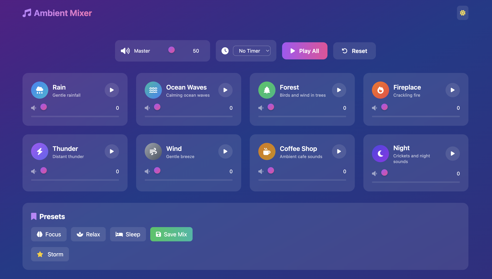

# Ambient Sound Mixer

An ambient sound mixer for combining looping sounds into a background for focus, relaxation, or sleep. Adjust each sound independently, choose a preset, or save a mix of your own.

This project was a **code-along made to learn object-oriented programming (OOP) concepts** in JavaScript. The app is organized into classes for sound playback, the interface, presets, and the timer.

## Preview

## Features

- Mix eight ambient sounds, each with its own volume control
- Control overall volume and play or pause all sounds together
- Load Focus, Relax, and Sleep presets
- Save custom mixes in the browser
- Set a sleep timer and switch the color theme

## Run locally

The project uses plain HTML, CSS, and JavaScript modules; there is no build step.

## OOP concepts in the code

- `AmbientMixer` coordinates the app in `js/app.js`.
- `SoundManager` handles audio playback in `js/soundManager.js`.
- `UI` renders and updates the interface in `js/ui.js`.
- `PresetManager` stores and loads mixes in `js/presetManager.js`.
- `Timer` manages the countdown in `js/timer.js`.

Sound definitions and the built-in presets live in `js/soundData.js`.

## Built with

- HTML, CSS, and vanilla JavaScript (ES modules)
- Tailwind CSS
- HTML audio elements for playback

## Project status

Learning project / code-along.
